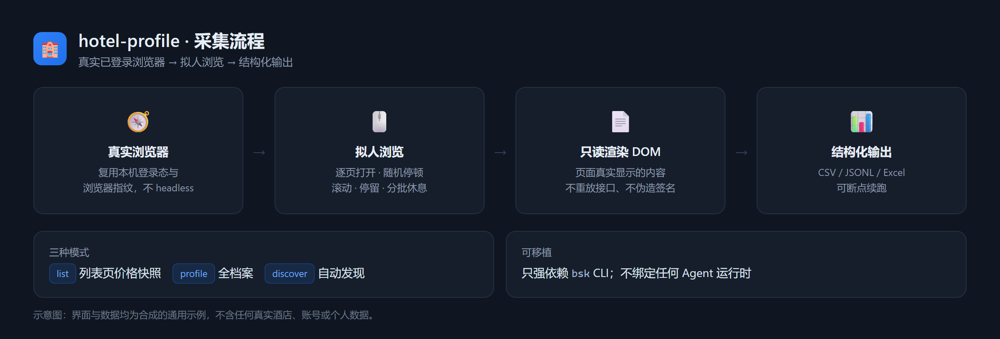
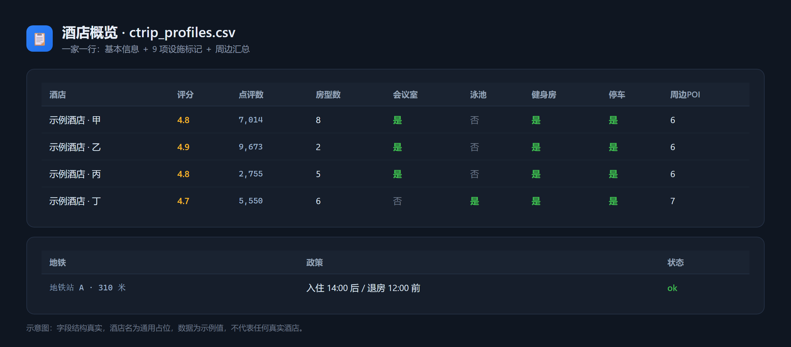
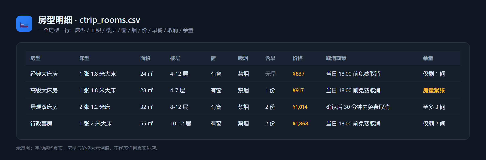

# hotel-profile

[中文 →](README.md)

Collect **hotel prices and full profiles** at scale by driving your **real, already-logged-in** Chrome/Edge through [BrowserSkill (`bsk`)](https://github.com/Tencent/BrowserSkill) — not just prices, but room types, meeting rooms, pools, nearby amenities, policies and more. It only reads the rendered DOM: no headless mode, no API replay, no cookie handling.



> Illustrations: synthetic, generic placeholder content. No real hotels, accounts or personal data.

The default platform adapter targets `platform.com`; selectors and URL templates live in `config/` and can be swapped for other platforms — the capability itself is not tied to one site.

---

## Why

Manually browsing a long hotel list is slow, while hitting internal APIs directly tends to get blocked. This project takes another route: **use your own browser and your own session, browse like a person**, then write what was rendered into structured files.

| | Direct API / headless scraper | This project |
| --- | --- | --- |
| Session | Move cookies yourself | Reuses the one already in your browser |
| Browser fingerprint | Must be forged | Genuinely real |
| Bot protection | Often blocked, needs workarounds | No workarounds — hands off to a human on a challenge |
| Data source | Internal APIs (unstable, easily blocked) | What the page actually renders |
| Speed | Fast | Slower (human pacing — by design) |

## What it collects

**Prices & ratings** (list page, `list` mode): sale price, struck-through original price, rating, review count, location, cancellation policy, promo tags.

**Full hotel profile** (detail page, `profile` mode):



- Basics: name, address, phone, rating, review count, description, highlight tags
- Facility flags: meeting room / pool / gym / restaurant / parking / spa / airport shuttle / WiFi / bar
- Nearby POIs: metro, landmarks, shopping, leisure — with distances
- Policies: check-in/out times, breakfast policy
- Room details: room name, bed type, area, floor, window, smoking, WiFi, price, breakfast, cancellation, availability



> Both images are **sanitized illustrations**: field structure is real, hotel names and values are generic placeholders.

**Facility flags are text-based only**: if the page says "meeting room" it records "yes", if not, "no" — it reflects page facts and never infers. See [references/data-schema.md](references/data-schema.md).

## Relationship with browser-skill

**A hard dependency, but only as an external CLI tool**: all browser actions go through the `bsk` CLI. This repo does not bundle or redistribute BrowserSkill, and does not depend on any particular agent runtime or injected tooling. Treat it like `git` or `python` — a prerequisite you install.

| Layer | Provided by | Shipped here |
| --- | --- | --- |
| Browser + platform session | Your own Chrome/Edge | No |
| `bsk` CLI/daemon + extension | [Tencent/BrowserSkill](https://github.com/Tencent/BrowserSkill) | No (install separately) |
| Rendered DOM | The target platform | No |
| SOP / selectors / Python driver / config templates | This repo | Yes (MIT) |

See [references/dependencies.md](references/dependencies.md).

## Prerequisites

1. Python 3.9+ (optionally `pip install -r requirements.txt`, only needed for xlsx output)
2. `bsk` on PATH (or set `BSK_CLI` / `bsk_cli` in `config/settings.json`) with the browser extension connected
3. An account already logged in on the target platform (member prices are invisible otherwise)
4. A reachable daemon: `BSK_AUTO_START=0 bsk status --json` should list `browsers[].instance_id`. A normal terminal auto-starts it; sandboxed/desktop hosts that forbid detaching need `BSK_AUTO_START=0 bsk daemon start --foreground` kept alive.

## Install / run

**Option 1 — npm / npx (one command)**

```bash
npx hotel-profile --mode list --limit 1        # no clone needed
npx hotel-profile --mode profile --limit 10
npm install -g hotel-profile                   # or install globally
```

The npm package ships the Python driver and config templates; it needs Python 3.9+ locally (set `HOTEL_PROFILE_PYTHON` to pin an interpreter) plus `bsk`. Use option 2 if you plan to edit selectors or keep persistent config.

**Option 2 — clone the repo (recommended long-term)**

```bash
git clone https://github.com/Frank-Fan-1058/hotel-profile.git && cd hotel-profile
python -m pip install -r requirements.txt
cp config/hotels.example.csv config/hotels.csv
cp config/hotels.profile.example.csv config/hotels.profile.csv

python scripts/verify_probe.py                 # connectivity + cooperation protocol self-check
python scripts/hotel_scraper.py --mode list --limit 1
python scripts/hotel_scraper.py --mode profile --limit 10
python scripts/hotel_scraper.py --mode discover --from-list "<list page URL>"
python -m unittest discover -s tests -v       # offline parser tests, no browser needed
```

## Modes

| Mode | What it does | Output |
| --- | --- | --- |
| `list` | Scrape all cards on a list page in one pass | `prices.csv` / `.jsonl` / `.xlsx` |
| `profile` | Open each hotel detail page for the full profile | `hotel_profiles.csv` + `hotel_rooms.csv` + `hotel_nearby.csv` + `hotel_report.xlsx` |
| `discover` | Auto-discover hotel IDs from a list page | `discovered_hotels.csv` |

Output goes to `./output` by default, **append-only with resume** (`progress*.json` tracks completed items), so repeated runs naturally build a price history.

## Configuration

- `config/settings.json`: publishable defaults (no personal paths). `bsk_cli` defaults to `"bsk"` (PATH); `output_dir` defaults to `"./output"`.
- `config/settings.local.json`: local overrides (gitignored). e.g. `{"output_dir": "D:/work/out"}`.
- `config/selectors.json`: field → CSS candidates. After a site redesign, run `--calibrate <url>` first; switching platforms mostly means editing this and the URL templates.

## Anti-detection design

Real profile session and TLS fingerprint → read only the rendered DOM → single tab, sequential, randomized pauses/scrolls/dwells/shuffles/long rests → on a captcha or login wall, `request-help` hands control to a human (`--no-handoff` records the state instead of blocking, for scheduled runs).

No headless mode, no UA spoofing, no cookie export, no signature forgery, no internal API replay, no concurrency to speed things up. See [references/anti-detection.md](references/anti-detection.md).

## Scheduling

DSH: built-in `schedule` + `--no-handoff`. Elsewhere: cron / systemd timer / Task Scheduler. On Windows the scripts spawn `bsk` with `CREATE_NO_WINDOW`, so no console window flashes.

## Scope and boundaries

- Reads only what the page **renders**; no reverse engineering, no replay, no challenge bypass.
- The session belongs to you: this tool never asks for, stores, or transmits credentials.
- Human pacing caps throughput; **not suitable for high-frequency polling**.
- Respect the target platform's terms of service and local law. This project provides tooling only and accepts no liability for its use.

## License

MIT, see [LICENSE](LICENSE). BrowserSkill is an independent project under its own license; this repo does not redistribute its binaries or source.
