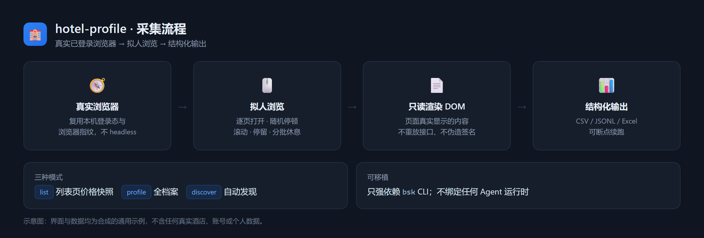
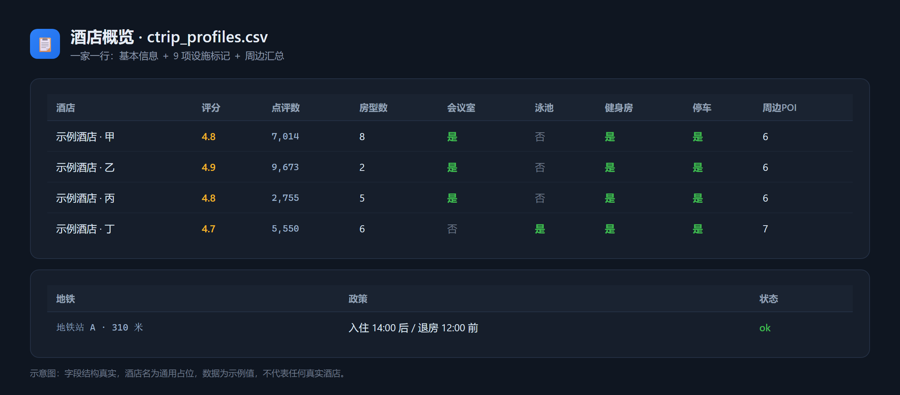
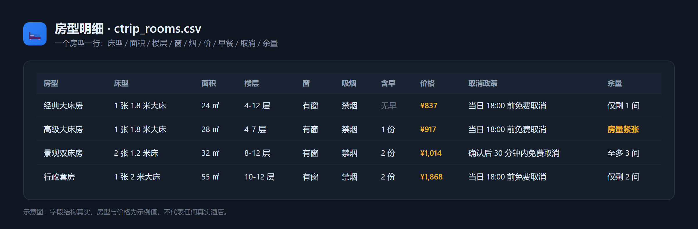

# hotel-profile

[English →](README.en.md)

在本机**真实已登录**的 Chrome/Edge 里，用 [BrowserSkill (`bsk`)](https://github.com/Tencent/BrowserSkill) 模拟真人浏览，批量采集**酒店价格与全档案**——不只价格，还有房型、会议室、泳池、周边配套、政策等参数。只读渲染后 DOM，不 headless、不重放 API、不碰 cookie。



> 示意图：界面与数据均为合成的通用示例，不含任何真实酒店、账号或个人数据。

当前默认平台适配器为 `ctrip.com`；选择器与 URL 模板集中在 `config/`，可换成其它平台，能力本身不绑定单一站点。

---

## 它解决什么

想批量了解一批酒店，靠人工一页页翻太慢，直连接口又容易被风控拦。这个项目走另一条路：**用你自己的浏览器、你自己的登录态，像人一样一页页看**，把看到的内容结构化落盘。

| | 直连接口 / headless 爬虫 | 本项目 |
| --- | --- | --- |
| 登录态 | 需要自己搬 cookie | 直接用浏览器里已有的 |
| 浏览器指纹 | 需要伪造 | 本来就是真的 |
| 页面风控 | 常被拦、要绕 | 不绕，遇验证码交真人 |
| 数据来源 | 内部接口（易变、易封） | 页面真实渲染的内容 |
| 速度 | 快 | 慢一些（拟人节奏，这是设计） |

## 采集什么

**价格与评分**（列表页，`list` 模式）：成交价、划线原价、评分、点评数、位置、取消政策、促销标签。

**酒店全档案**（详情页，`profile` 模式）：



- 基本信息：酒店名、地址、电话、评分、点评数、简介、亮点标签
- 设施标记：会议室 / 泳池 / 健身房 / 餐厅 / 停车场 / SPA / 接送机 / WiFi / 酒吧
- 周边配套：地铁站、地标、购物、休闲娱乐等 POI 及距离
- 酒店政策：入离时间、早餐政策
- 房型明细：房型名、床型、面积、楼层、有窗/禁烟、WiFi、房价、早餐、取消政策、余量



> 两图均为**脱敏示意图**：字段结构真实，酒店名与数值为通用占位，不代表任何真实酒店。

**设施标记只按页面文本判定**：页面写了「会议厅」记「是」，没写就记「否」——只反映页面事实，不做推断。字段口径见 [references/data-schema.md](references/data-schema.md)。

## 它跟 browser-skill 是什么关系

**强依赖，但只是外部命令行依赖**：核心动作全走 `bsk` CLI。本仓库不含也不分发 BrowserSkill 本体，不依赖任何特定 Agent 运行时或注入式工具。把它当 `git` / `python` 一类的前置工具装好即可。

| 层 | 谁提供 | 随本仓库发布 |
| --- | --- | --- |
| 浏览器 + 平台登录态 | 你自己的 Chrome/Edge | 否 |
| `bsk` CLI/daemon + 扩展 | [Tencent/BrowserSkill](https://github.com/Tencent/BrowserSkill) | 否（自行安装） |
| 平台渲染后 DOM | 目标平台 | 否 |
| SOP / 选择器 / Python 驱动 / 配置模板 | 本仓库 | 是（MIT） |

详见 [references/dependencies.md](references/dependencies.md)。

## 前置

1. Python 3.9+（可选 `pip install -r requirements.txt`，仅用于输出 xlsx）
2. `bsk` 在 PATH（或设 `BSK_CLI` / `config/settings.json` 的 `bsk_cli` 绝对路径）＋ 浏览器扩展已连接
3. 真实浏览器里已登录目标平台账号（未登录看不到会员价）
4. daemon 可用：`BSK_AUTO_START=0 bsk status --json` 能看到 `browsers[].instance_id`。普通终端 `bsk` 会自动拉起；桌面宿主类环境（禁止后台进程脱离）需手动常驻 `BSK_AUTO_START=0 bsk daemon start --foreground`。

## 安装 / 运行

**方式一：npm / npx（一行跑起来）**

```bash
npx hotel-profile --mode list --limit 1        # 无需克隆，直接运行
npx hotel-profile --mode profile --limit 10
npm install -g hotel-profile                   # 或全局安装后用 hotel-profile 命令
```

npm 包内含 Python 驱动与配置模板；运行时需要本机有 Python 3.9+（可用 `HOTEL_PROFILE_PYTHON` 指定解释器）与 `bsk`。想改选择器或持久化配置，用方式二。

**方式二：从仓库克隆（推荐长期使用）**

```bash
git clone https://github.com/Frank-Fan-1058/hotel-profile.git && cd hotel-profile
python -m pip install -r requirements.txt
cp config/hotels.example.csv config/hotels.csv
cp config/hotels.profile.example.csv config/hotels.profile.csv

python scripts/verify_probe.py                 # 自检：bsk 连通 + 协作协议
python scripts/ctrip_hotel.py --mode list --limit 1
python scripts/ctrip_hotel.py --mode profile --limit 10
python scripts/ctrip_hotel.py --mode discover --from-list "<列表页URL>"
python -m unittest discover -s tests -v       # 离线解析测试，不需浏览器
```

## 三种模式

| 模式 | 做什么 | 输出 |
| --- | --- | --- |
| `list` | 列表页一次抓整页卡片 | `ctrip_prices.csv` / `.jsonl` / `.xlsx` |
| `profile` | 逐家详情页取全档案 | `ctrip_profiles.csv` + `ctrip_rooms.csv` + `ctrip_nearby.csv` + `ctrip_hotel_full.xlsx` |
| `discover` | 从列表页自动发现酒店 ID | `discovered_hotels.csv` |

输出默认在 `./output`，**追加写 + 断点续跑**（`progress*.json` 记已完成），多次运行自然形成价格快照历史。

## 配置

- `config/settings.json`：可发布默认值（无个人路径）。`bsk_cli` 默认 `"bsk"` 走 PATH；`output_dir` 默认 `"./output"`。
- `config/settings.local.json`：本机私有覆盖（已 gitignore）。例：`{"output_dir": "D:/work/产出"}`。
- `config/selectors.json`：字段 → CSS 候选。页面改版先 `--calibrate <url>` 再调；换平台主要改这里与 URL 模板。

## 抗反爬设计

复用真实 profile 的登录态与 TLS 指纹 → 只读渲染后 DOM → 串行单标签 + 随机停顿/滚轮/停留/乱序/长休息 → 遇验证码或登录墙 `request-help` 交真人（后台加 `--no-handoff` 只记状态）。

不 headless、不改 UA、不导出 cookie、不伪造签名、不重放内部 API、不并发提速。详见 [references/anti-detection.md](references/anti-detection.md)。

## 定时

DSH：内置 `schedule` + `--no-handoff`；其他环境：cron / systemd timer / 任务计划程序。Windows 下脚本用 `CREATE_NO_WINDOW` 起子进程，不弹黑窗。

## 契约与边界

- 只读取页面**渲染后**的内容；不逆向、不重放、不绕过验证。
- 登录态归使用者，本工具不索取、不存储、不外传任何账号凭据。
- 采集频率受拟人节奏限制，**不适合高频轮询**。
- 数据归属与使用范围请遵守目标平台的用户协议与当地法规；本项目只提供技术手段，不承担使用后果。

## 许可

MIT，见 [LICENSE](LICENSE)。BrowserSkill 为独立项目，许可以其仓库为准；本仓库不分发其二进制或源码。
